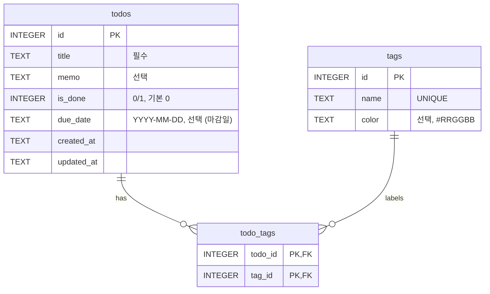

# DB 설계 — Todo 앱 (SQLite)

PRD.md 기준: 기본 CRUD + 마감일 + 태그(여러 개).

> **Supabase 버전:** 지금 앱은 이 구조를 Postgres 로 옮긴 [supabase/schema.sql](supabase/schema.sql) 을 써요.
> 달라진 점: `todos`·`tags` 에 소유 사용자 `user_id`(→ `auth.users`) 추가, 태그 이름은 사용자별로 UNIQUE,
> `is_done` 은 boolean, `due_date` 는 date, 세 표 모두 RLS 로 "로그인한 본인 데이터만" 허용.

## 구조도 (ERD)



## 표 설명

| 표 | 역할 |
|---|---|
| `todos` | 할 일 한 건. 완료 여부(`is_done`)와 마감일(`due_date`)을 직접 가짐 |
| `tags` | 태그 목록 (예: 업무, 공부, 장보기). 이름 중복 불가 |
| `todo_tags` | 할 일 ↔ 태그 연결표. 할 일 하나에 태그 여럿, 태그 하나에 할 일 여럿 (N:M) |

**왜 연결표?** 태그를 `todos`에 문자열로 넣으면(`"업무,공부"`) 태그 이름 변경·태그별 필터가 어려워져요. 연결표로 나누면 둘 다 쉬워져요.

**왜 날짜가 TEXT?** SQLite엔 날짜 타입이 없어요. `YYYY-MM-DD` 형식 문자열은 그대로 정렬·비교(`<`, `>`)가 돼요.

## 테이블 생성 SQL

```sql
PRAGMA foreign_keys = ON;  -- SQLite는 연결마다 켜야 FK가 동작함

CREATE TABLE todos (
    id         INTEGER PRIMARY KEY AUTOINCREMENT,
    title      TEXT    NOT NULL,
    memo       TEXT,
    is_done    INTEGER NOT NULL DEFAULT 0 CHECK (is_done IN (0, 1)),
    due_date   TEXT,
    created_at TEXT    NOT NULL DEFAULT (datetime('now', 'localtime')),
    updated_at TEXT    NOT NULL DEFAULT (datetime('now', 'localtime'))
);

CREATE TABLE tags (
    id    INTEGER PRIMARY KEY AUTOINCREMENT,
    name  TEXT NOT NULL UNIQUE,
    color TEXT
);

CREATE TABLE todo_tags (
    todo_id INTEGER NOT NULL REFERENCES todos(id) ON DELETE CASCADE,
    tag_id  INTEGER NOT NULL REFERENCES tags(id)  ON DELETE CASCADE,
    PRIMARY KEY (todo_id, tag_id)
);

CREATE INDEX idx_todos_due_date ON todos(due_date);
CREATE INDEX idx_todo_tags_tag  ON todo_tags(tag_id);
```

`ON DELETE CASCADE`: 할 일을 지우면 그 할 일의 태그 연결도 같이 지워짐 (태그 자체는 남음).

## 기능별로 쓰이는 쿼리 예시

```sql
-- 마감 지난 미완료 할 일
SELECT * FROM todos
WHERE is_done = 0 AND due_date < date('now', 'localtime');

-- '공부' 태그가 붙은 할 일
SELECT t.* FROM todos t
JOIN todo_tags tt ON tt.todo_id = t.id
JOIN tags g       ON g.id = tt.tag_id
WHERE g.name = '공부';

-- 목록: 마감일 빠른 순 (마감일 없는 건 맨 뒤)
SELECT * FROM todos ORDER BY due_date IS NULL, due_date;
```
