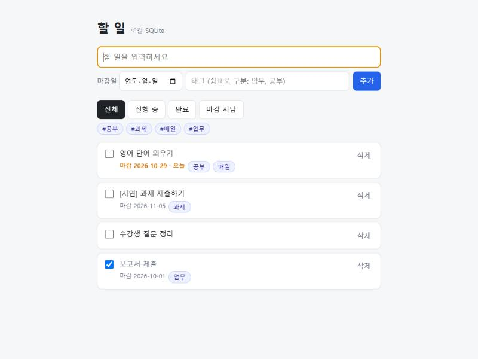
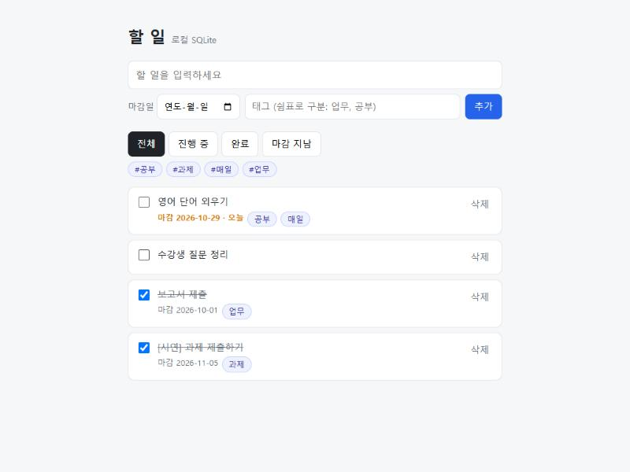
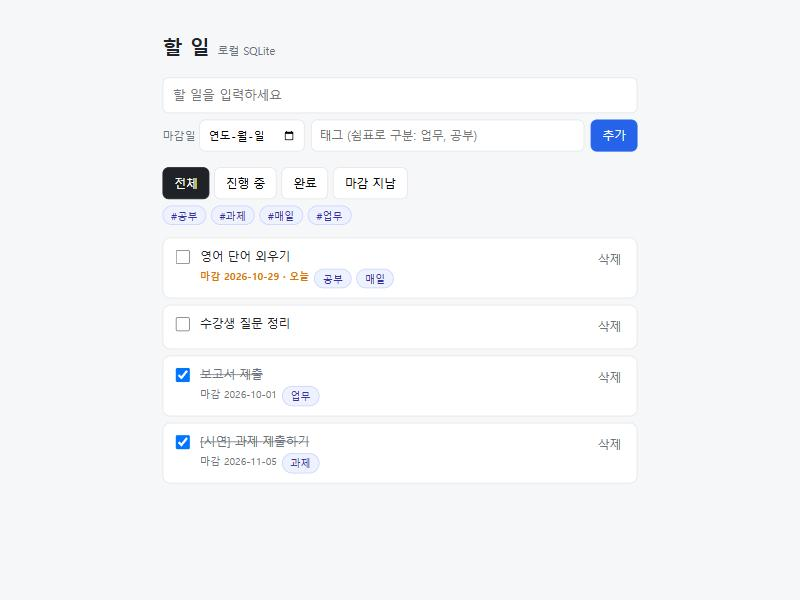
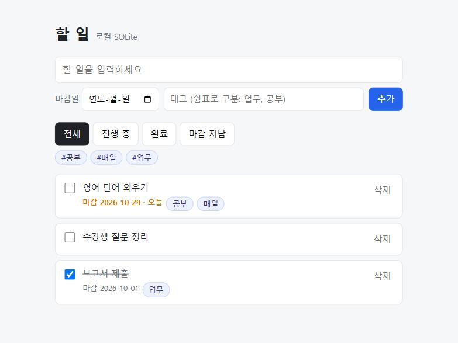
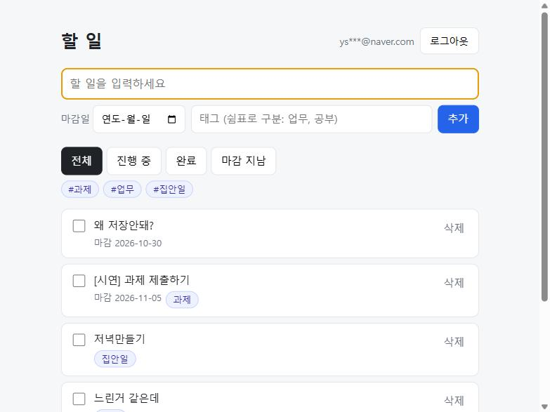
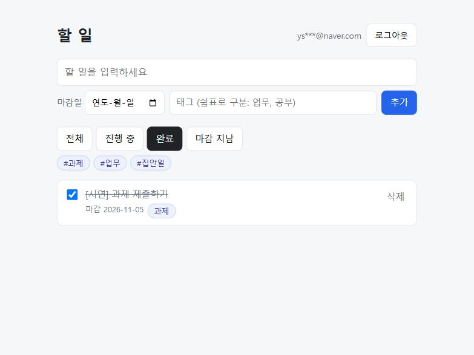
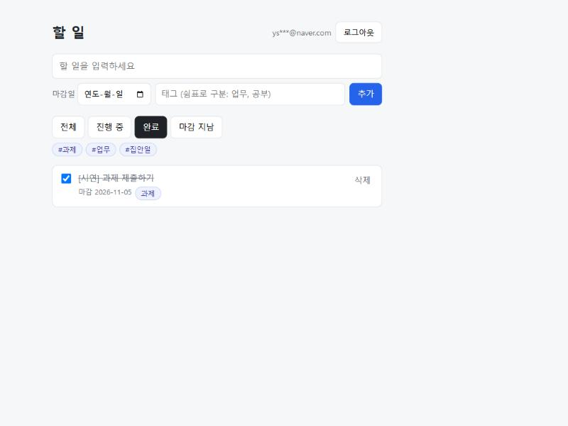
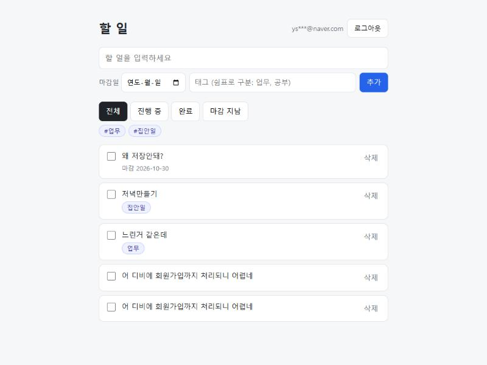
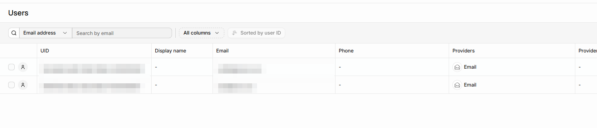
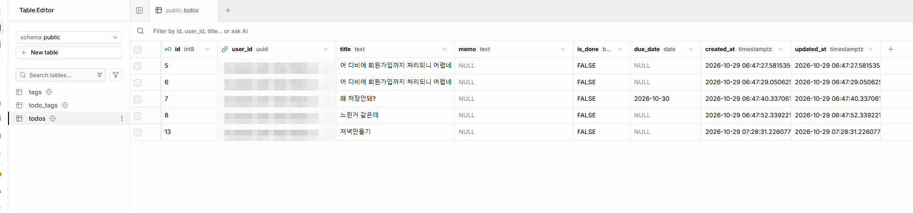

# 시연 화면 — 데이터가 남는 Todo 앱

2026-10-29 촬영. 길 A(로컬 SQLite)와 길 B(Supabase) 각각
**추가 → 완료 → 서버 재시작 후에도 남음 → 삭제** 순서로 찍었어요.
(공개 저장소라 화면의 이메일은 일부 가렸어요.)

## 길 A: 로컬 SQLite (`npm run start:sqlite`, http://localhost:3001)

| 1. 추가 | 2. 완료 체크 |
|---|---|
|  |  |
| `[시연] 과제 제출하기` (마감일·태그 포함) 추가 | 체크하면 줄이 그어지고 맨 아래로 |

| 3. 서버 재시작 후 | 4. 삭제 |
|---|---|
|  |  |
| 서버를 끄고 다시 켠 뒤에도 할 일과 완료 상태 그대로 (`sqlite-version/todo.db` 파일에 저장) | 삭제하면 목록과 안 쓰는 `#과제` 태그가 사라짐 |

## 길 B: Supabase + 로그인 (`npm start`, http://localhost:3000)

| 1. 추가 | 2. 완료 체크 (완료 필터) |
|---|---|
|  |  |
| 로그인한 상태에서 추가 → Supabase `todos` 표에 내 `user_id` 로 저장 | 완료 필터에서 완료된 할 일 확인 |

| 3. 서버 재시작 후 | 4. 삭제 |
|---|---|
|  |  |
| 서버를 끄고 다시 켠 뒤 다시 들어와도 완료 상태 그대로 (클라우드 DB 에 저장) | 삭제 후 목록과 `#과제` 태그가 사라지고, 기존 할 일은 그대로 |

## RLS 확인용: 계정 두 개

Supabase 대시보드 → Authentication → Users. 테스트에 쓴 계정 A·B 두 개 (UID·이메일은 모자이크).
두 계정으로 각각 로그인해 B 에게 A 의 할 일이 보이지 않고, A 의 할 일 수정·삭제 요청이 404 로 거절되는 것을 확인.

## 클라우드 저장 확인: Table Editor

Supabase 대시보드 → Table Editor → `todos`. 앱에서 만든 할 일이 클라우드 DB 에 행으로 저장되고,
행마다 소유 계정 `user_id` 가 기록됨 (값은 모자이크). 대시보드는 관리자 화면이라 RLS 와 상관없이 전체 행이 보임.

확인 절차와 RLS(본인 데이터만) 기록은 [VERIFY.md](VERIFY.md).
